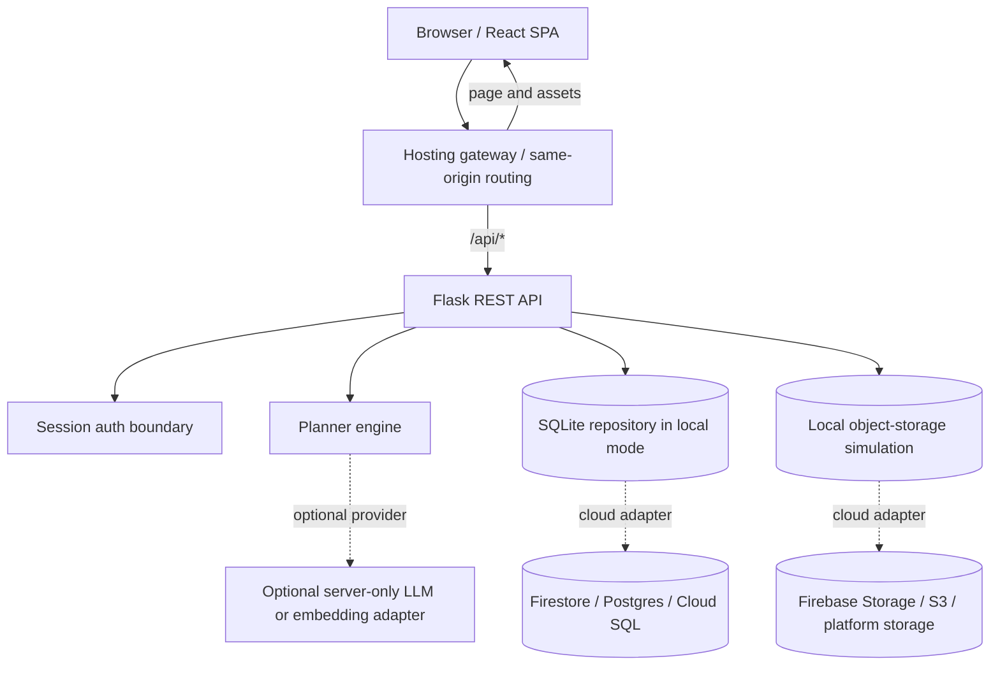

# Architecture and cloud concept map

## Runtime architecture

During local development, Vite serves the SPA on port 3000 and proxies `/api` to Flask on port 5000. In a production-style container, the frontend is built to `frontend/dist` and Flask serves the SPA plus API from one container on `$PORT`. A split deployment can serve hashed frontend assets statically and route `/api/*` to the Flask service.

## Main data ownership model

| Record | Local implementation | Owner rule | Cloud migration |
|---|---|---|---|
| `users` | SQLite table | User identity is selected by session | Managed auth user ID plus user profile document |
| `profiles` | One row per user | `WHERE user_id = session user` | `/users/{uid}/profile/main` in Firestore or a SQL row |
| `plans` | JSON payload per user | Plan query always includes owner | `/users/{uid}/plans/{planId}` or SQL JSON column |
| `intake` | One row per food entry/date | User/date query is scoped by owner | `/users/{uid}/intake/{date}` or normalized SQL rows |
| `uploads` | Metadata row plus `data/uploads` bytes | User owns metadata and download route | DB metadata plus durable object key |
| `foods` | Versioned Python catalog | Read-only server-side catalog | Public authenticated catalog collection/table |

## Request flow

1. A user loads the React application. `GET /api/auth/me` returns an authenticated user or a logged-out state.
2. The user saves a profile. Flask validates bounds and categories before persisting it.
3. `POST /api/targets` calculates BMR, TDEE, adjusted calories, and a default macro split on the server so the browser cannot change the calculation logic.
4. `POST /api/plans` reads the stored profile, filters the food catalog, creates four meal groups, returns approximate totals, and persists the JSON plan.
5. The dashboard calls `GET /api/dashboard` to combine profile, targets, newest plan, today’s intake, and recent plan metadata.
6. `POST /api/intake` calculates nutrition from the server catalog and stores the entry; the next dashboard request reflects the aggregate.
7. Profile image uploads are validated by Flask, saved through the storage adapter, and recorded in `uploads` with an ownership-scoped download route.

## Cloud-computing concepts in this project

| Concept | Where it appears |
|---|---|
| SaaS | A user-facing hosted web service with account-specific plans and tracking. |
| PaaS | Cloud Run/container hosting, managed SQL/Firestore, managed object storage, and managed identity. |
| IaaS | The underlying compute/network/storage resources are abstracted by the platform; the Dockerfile still defines the application runtime boundary. |
| Client-server architecture | React browser client communicates with Flask JSON endpoints. |
| REST API | `/api/auth`, `/api/profile`, `/api/targets`, `/api/plans`, `/api/intake`, `/api/dashboard`, and `/api/storage`. |
| Authentication | Password hashing and session cookie locally; managed auth adapter is documented for cloud. |
| Authorization | Each protected query includes the authenticated owner ID. |
| Cloud database | SQLite repository is intentionally replaceable with Firestore, Postgres, or Cloud SQL. |
| Object storage | File bytes are separated from upload metadata; local adapter maps to Firebase Storage/S3. |
| Serverless computing | Targets/plans can be moved to callable or HTTP functions while keeping the JSON contract. |
| API gateway | Production route split sends `/api/*` to a container and frontend routes/assets to static hosting. |
| Environment variables | Secret key, database path, upload root, and port are runtime settings. |
| Secrets management | No credentials are committed; production secrets belong in provider secret management. |
| Scalability | Stateless API instances scale horizontally after shared persistence replaces local disk. |
| Elasticity | Managed container instances can scale up/down with traffic. |
| Availability | Health endpoint, durable managed services, and multi-instance deployment are the next production step. |
| Load balancing | Cloud Run/gateway can distribute API requests across replicas. |
| Logging/monitoring | Flask stdout and provider logs support error/latency health checks. |
| CI/CD | Tests/builds can run in GitHub Actions before container publication. |

## Security boundary

Local simulation demonstrates basics but is not a healthcare production system. Passwords are hashed, cookies are HTTP-only, inputs are validated, filenames are sanitized, upload size/types are constrained, and queries are parameterized. The app does not store clinical records and explicitly labels generated output as educational.

Before public deployment, replace the local auth adapter with managed identity, enforce HTTPS and secure cookie flags, add CSRF/rate limiting, store secrets in a managed secret service, replace SQLite and local uploads with shared services, add dependency scanning, and define user-data retention/deletion rules. Avoid sending user profile data to an LLM unless the feature, provider, retention policy, and consent model are explicit.
